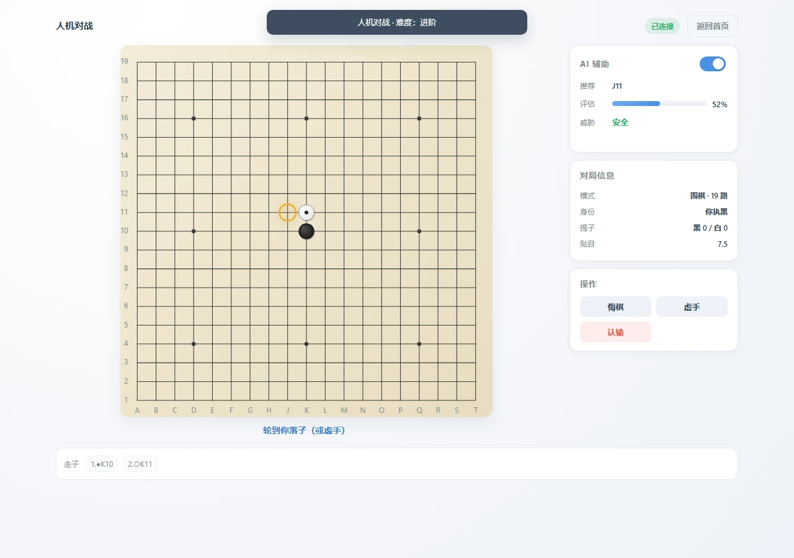

# 棋盘对弈 · Gomoku Duel

> 浏览器端五子棋 / 围棋，支持 **WebRTC 点对点联机**、**人机对战** 与 **本地 AI 辅助**。纯静态、零构建、无后端，打开网页即可对局。

[](https://github.com/Alexander-cloud123/gomoku-duel/actions/workflows/ci.yml)
[](LICENSE)
[](package.json)
[](https://gomoku-duel.pages.dev/)

**在线体验**：[gomoku-duel.pages.dev](https://gomoku-duel.pages.dev/)（主站）· [GitHub Pages 镜像](https://alexander-cloud123.github.io/gomoku-duel/)




## 目录

- [项目简介](#项目简介)
- [功能特性](#功能特性)
- [快速开始](#快速开始)
- [使用指南](#使用指南)
- [规则与计分](#规则与计分)
- [架构与目录](#架构与目录)
- [技术栈](#技术栈)
- [开发与测试](#开发与测试)
- [部署](#部署)
- [配置项](#配置项)
- [浏览器支持](#浏览器支持)
- [已知限制](#已知限制)
- [贡献与安全](#贡献与安全)
- [许可证与第三方](#许可证与第三方)

## 项目简介

一个完全在浏览器中运行的双人棋类应用：房主生成 6 位房间号，对手输入即可通过 WebRTC 直连，**对局数据不经过任何服务器**；也可以直接与本地 AI 对战。

它不是一个在线游戏平台——没有账号、匹配、排行、观战，也没有服务端存储。全部逻辑（规则、状态机、渲染、AI）都在客户端，站点只是静态文件。

| 维度 | 说明 |
| --- | --- |
| 形态 | 纯静态单页应用，部署即用 |
| 联机 | WebRTC 点对点（PeerJS），房主为状态权威 |
| 构建 | 无构建步骤；HTML + CSS + ES Modules 直接加载 |
| 数据 | 不收集用户数据；仅本地保存设置与战绩 |
| AI | 本地 Web Worker 计算，零 API、零联网 |

## 功能特性

### 联机对战（P2P）

- 6 位房间号创建 / 加入，支持深链邀请 `?room=CODE&mode=...`
- 握手校验棋种、棋盘尺寸、贴目与协议版本；模式不匹配时明确拒绝并自动切换
- 落子经双端规则校验；消息带版本与序号，重复丢弃、缺口自动重同步
- 心跳检测 + 60 秒断线重连窗口，重连后按房主快照恢复盘面
- 悔棋 / 和棋 / 认输 / 再来一局均需对方同意，带冷却与单槽位约束
- 房间满员、房间不存在、创建冲突等错误均有中文提示

### 人机对战

- 三档难度：入门 / 进阶 / 高手，五子棋与围棋共用入口
- AI 在 Web Worker 中思考，主线程不卡顿；Worker 不可用时自动降级并缩短预算
- 围棋 AI 会判断虚手，规避自杀与打劫禁着

### 围棋

- 9 / 13 / 19 路，贴目 5.5 / 6.5 / 7.5
- 提子、自杀禁着、打劫、位置超级劫
- 双虚手进入点目：可点击棋组标记死子，双方确认后按中国规则数子结算
- 悔棋截断历史后完整回放，提子数与劫状态不会丢失

### AI 辅助（设置中可关闭）

- 推荐落点与备选点
- 局面评估（棋型启发式，非概率真值）
- 对手威胁提示（活四 / 冲四 / 双三 / 四三）
- 全部在本地计算，无外部请求

### 体验

- Canvas 按设备像素比渲染，移动端清晰不糊
- 指针 / 键盘双输入：方向键移动光标，Enter 落子
- 落子动画、最后一手标记、连五高亮、打劫标记、落子音效
- 统一模态框（替代 `alert` / `confirm`）、Toast、焦点陷阱、Esc 关闭
- 深色 / 浅色系统主题适配，`prefers-reduced-motion` 下关闭动画
- 本地战绩统计与可滚动走子记录

## 快速开始

要求 Node.js 20 及以上（仅用于开发服务器与测试；**运行游戏本身不需要 Node**）。

```bash
git clone https://github.com/Alexander-cloud123/gomoku-duel.git
cd gomoku-duel
npm ci
npm run dev
```

打开 <http://127.0.0.1:5173/>。

> 不要直接双击 `index.html`：`file://` 协议下 ES Module 与 Web Worker 会被浏览器拦截。请使用开发服务器，或部署到任意静态服务器。

### 常用命令

| 命令 | 作用 |
| --- | --- |
| `npm run dev` | 本地静态服务器（127.0.0.1:5173） |
| `npm run lint` | ESLint 检查 |
| `npm test` | Node 内置测试运行器（规则 / 协议 / 会话 / AI） |
| `npm run check:ids` | 页面元素 id 与脚本引用一致性 |
| `npm run check:docs` | 文档相对链接与图片存在性 |
| `npm run ci` | 以上检查与全部测试（CI 同款） |

## 使用指南

### 联机

1. 房主选择棋种与设置，点击「创建房间」
2. 把房间号或邀请链接发给对手
3. 对手点击「加入房间」输入房间号，或直接打开邀请链接
4. 房主执黑先行

邀请链接格式：`https://<站点>/?room=ABCDEF&mode=go`（`mode` 可省略，加入时会自动校验）。

### 人机

1. 首页切换到「人机对战」
2. 选择棋种与难度，点击「开始人机对战」
3. 玩家执黑，AI 执白

### 断线与重连

连接中断时页面显示「连接中断，正在恢复…」。60 秒内恢复会重新同步盘面；超时则判定对手离开，返回首页。断线期间的操作不会重放。

## 规则与计分

- **五子棋**：15 路，无禁手，任意方向连成 5 子即胜（6 子及以上同样判胜）；棋盘下满且无人连五为和棋。
- **围棋**：中国规则数子（子 + 地），白方贴目；连续两次虚手进入点目；死子由双方标记并确认后结算；打劫与位置超级劫禁止重复局面。
- **AI 评估**：界面中的「评估」是基于棋型与搜索分数的启发式估计，不代表真实胜率。

## 架构与目录

规则内核与状态机不依赖 DOM，可在 Node 中直接测试；网络拆分为传输、协议、会话三层，AI 运行在 Worker 中。

```
index.html                  页面结构
style.css                   样式（响应式 / 模态 / Toast / 主题）
js/
  main.js                   模块入口
  app.js                    应用控制器（页面流转、联机 / PvE 调度）
  board.js                  棋盘视图（Canvas、DPR、输入、动画）
  game.js                   对局状态机（规则、悔棋、终局点目）
  room.js                   房间号生成与兼容解析
  rules/                    纯规则：五子棋 / 围棋 / Zobrist / 常量与记谱
  net/                      传输（PeerJS）、协议、会话（握手 / 心跳 / 重连）
  ai/                       棋型、五子棋引擎、围棋引擎、Worker、客户端
  ui/                       页面、模态、Toast、本地设置与战绩
lib/
  peerjs.min.js             第三方运行时库（PeerJS 1.5.4，MIT）
  README.md                 版本、来源与升级步骤
  peerjs.LICENSE            许可证原文
assets/favicon.svg          站点图标
scripts/                    开发服务器、一致性检查、冒烟脚本
tests/                      规则 / 协议 / 会话 / AI 测试
docs/
  ARCHITECTURE.md           模块划分、数据流、设计取舍
  PROTOCOL.md               联机消息格式与状态机
  TESTING.md                测试矩阵与冒烟方法
  REPOSITORY-STANDARDS.md   仓库纳管规范
  archive/                  历史设计稿（不代表当前事实）
.github/                    CI、Issue / PR 模板、Dependabot、CODEOWNERS
.githooks/pre-push          可选：推送前本地校验
```

更详细的设计见 [docs/ARCHITECTURE.md](docs/ARCHITECTURE.md)，联机协议见 [docs/PROTOCOL.md](docs/PROTOCOL.md)，仓库规范见 [docs/REPOSITORY-STANDARDS.md](docs/REPOSITORY-STANDARDS.md)。

## 技术栈

- 原生 HTML / CSS / ES Modules，无框架、无打包器、无运行时 CDN 依赖
- Canvas 2D 渲染，静态层离屏缓存，动态层按 DPR 缩放
- WebRTC（PeerJS 1.5.4，vendored 至 `lib/`）
- Web Worker + 迭代加深 Alpha-Beta + 置换表（五子棋）；一手启发式（围棋）
- Node 内置测试运行器 + ESLint（开发期）
- GitHub Actions（Node 20 / 22）与 Cloudflare Pages（自动部署）

## 开发与测试

```bash
npm run ci
```

当前 62 项自动化用例，覆盖：

| 测试文件 | 覆盖 |
| --- | --- |
| `tests/gomoku-rules.test.mjs` | 落子、四方向连五、六连、满盘 |
| `tests/go-rules.test.mjs` | 棋组与气、提子、自杀、打劫、超级劫、数子、死子 |
| `tests/game.test.mjs` | 回合校验、胜负、悔棋、认输、双虚手点目、快照恢复 |
| `tests/notation.test.mjs` | 坐标记谱、棋盘尺寸、Zobrist |
| `tests/protocol.test.mjs` | 版本、信封、载荷范围、快照校验、体积上限 |
| `tests/session.test.mjs` | 握手、落子、去重、伪造消息、悔棋、认输、和棋、重开、点目、重连 |
| `tests/ai.test.mjs` | 棋型识别、威胁、选点、堵四、时间预算、围棋合法性 |

联机会话测试使用内存传输，不依赖浏览器或 PeerJS；浏览器冒烟脚本见 [docs/TESTING.md](docs/TESTING.md)（14 项 UI 检查，真实 PeerJS 联机 10 项）。CI 在 Node 20 / 22 上执行 lint、页面 id 检查、文档链接检查与全部测试。

## 部署

站点即仓库根目录，无构建产物。

### GitHub Pages（镜像站）

1. 推送 `main`
2. Settings → Pages → Source: `main` / `(root)`
3. 访问 `https://<用户名>.github.io/gomoku-duel/`

### Cloudflare Pages（主站）

仓库已与 Cloudflare Pages 连接，推送 `main` 后自动重建并发布到 <https://gomoku-duel.pages.dev/>。

> 两处站点默认按 `main` 最新提交部署，静态资源使用协商缓存；更新后如看到旧页面，请强制刷新（`Ctrl+F5`）。

运行时只需 `index.html` + `js/` + `lib/` + `assets/` + `style.css`，不需要 npm 依赖。

## 配置项

| 项 | 说明 |
| --- | --- |
| 棋种 | 五子棋（15 路） / 围棋（9、13、19 路） |
| 贴目 | 5.5 / 6.5 / 7.5（仅围棋） |
| 难度 | 入门 / 进阶 / 高手（人机对战与 AI 辅助共用） |
| AI 辅助 | 设置中可关闭；辅助在本地计算 |
| 深链参数 | `?room=CODE`、`?mode=gomoku|go` |
| 本地存储 | `localStorage` 键 `gomoku-duel:v2`（设置与战绩，无敏感数据） |

## 浏览器支持

Chrome / Edge / Firefox / Safari 15+，以及现代移动浏览器。依赖 WebRTC、Canvas 2D、ES Modules 与 Web Worker；不支持 IE。

## 已知限制

- 未接入浏览器自动化到 CI，Canvas 交互依赖冒烟脚本与手工矩阵（[docs/TESTING.md](docs/TESTING.md)）
- PeerJS 使用公共信令服务器；严格 NAT 环境需要自建 TURN（`Transport` 已预留 ICE 配置）
- 断线重连以房主状态为准，断线期间的操作不重放
- 围棋 AI 为启发式，不承诺棋力；五子棋 AI 的「评估」不是胜率真值

## 贡献与安全

- 提交前请阅读 [CONTRIBUTING.md](CONTRIBUTING.md)（分支、提交规范、测试要求）与 [CODE_OF_CONDUCT.md](CODE_OF_CONDUCT.md)
- 安全问题请通过 [私密漏洞报告](https://github.com/Alexander-cloud123/gomoku-duel/security/advisories/new) 提交，详见 [SECURITY.md](SECURITY.md)
- 仓库纳管范围与分支策略见 [docs/REPOSITORY-STANDARDS.md](docs/REPOSITORY-STANDARDS.md)

## 许可证与第三方

项目代码以 [MIT](LICENSE) 许可发布。随站点分发的第三方库（PeerJS，MIT）及其版本、来源与许可证见 [THIRD_PARTY_NOTICES.md](THIRD_PARTY_NOTICES.md) 与 [lib/README.md](lib/README.md)。

版本与变更记录见 [CHANGELOG.md](CHANGELOG.md)。

---

## English Summary

A browser-based Gomoku / Go game with WebRTC peer-to-peer play, local AI opponent (Web Worker) and an in-game AI assistant. Fully static, zero build, no backend, no accounts. Rules engine and state machine are DOM-free and unit-tested; the network layer is split into transport, protocol and session with versioning, deduplication and resynchronisation. MIT licensed.
